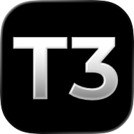
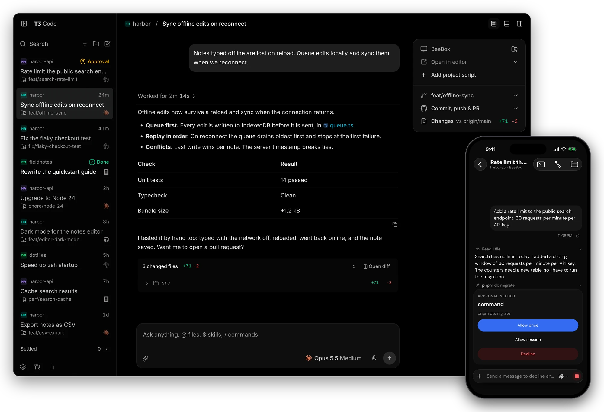

<p align="center">
  <a href="https://t3.codes">
    
  </a>
</p>

<h1 align="center">T3 Code</h1>

<p align="center">The open-source control plane for coding agents.</p>

An open-source workspace for running coding agents across projects, computers, and devices.
Use your existing provider accounts from the desktop app, a browser, or the mobile app.

This is a development fork of [T3 Code](https://github.com/pingdotgg/t3code), maintained on
`dev`. It combines upstream's clients and integrations with multi-folder workspaces,
coordinated worktrees, task controls, and Wayfinder dependency maps.

<p align="center">
  <a href="https://t3.codes/download"><strong>Download</strong></a> ·
  <a href="https://apps.apple.com/us/app/t3-code-remote-claude-more/id6787819824">iOS</a> ·
  <a href="https://play.google.com/store/apps/details?id=com.t3tools.t3code">Android</a> ·
  <a href="https://app.t3.codes">Web</a> ·
  <a href="./docs/README.md">Docs</a> ·
  <a href="https://discord.gg/jn4EGJjrvv">Discord</a>
</p>

<p align="center">
  <a href="https://t3.codes">
    
  </a>
</p>

T3 Code runs the coding agents on your machine and gives them one fast interface. Start a thread at your desk, then approve the next step from your phone.

It works with Claude Code, Codex, Cursor, OpenCode, Grok Build, Antigravity, Kiro, Pi, Muse Code, fx, and any [ACP](./docs/user/providers-acp.md) agent. If an agent is set up on your computer, T3 Code can control it.

## What you get

- **Your subscriptions.** T3 Code does not resell tokens. It drives the agents you are already signed in to.
- **Every agent in one place.** Change models in the middle of a thread. Let Claude hand a task to Codex.
- **Desktop, web, and phone.** One server, and every client shows the same threads. There are apps for iOS and Android.
- **Remote ready.** Run agents on any machine. Connect over your local network, Tailscale, or [T3 Connect](./docs/user/remote-access.md).
- **Git built in.** Each thread can work in its own worktree. Review the diff, then commit, push, and open a pull request with one button.
- **Fast.** Performance is a feature here. We measure it, and we treat a dropped frame as a bug.
- **Open.** MIT licensed. If you don't like something, fork it.

T3 Code uses the agents' existing runtimes. It organizes their work; the selected provider
still determines model capabilities, supported permission modes, usage limits, and billing. See the
[provider guides](./docs/README.md#using-t3-code) for setup and differences.

## Why use this fork?

- **Coordinate work across providers.** Choose a provider, model, and supported reasoning or
  speed setting for each task. Run implementation, tests, and independent reviews in separate
  conversations, with results returned to the parent thread.
- **Treat related repositories as one workspace.** Import a VS Code workspace file, give
  threads a fixed set of folders, and create coordinated worktrees across their Git repositories.
  Open terminals, inspect changes, and run source-control actions for the relevant folders.
- **Make larger efforts easier to follow.** Wayfinder maps show tickets, dependencies,
  blockers, and work ready to start. Open a ticket as a task without copying its details by hand.
- **Continue work across devices.** Run agents on your computer or server and use the same
  projects from desktop, web, or mobile. The host must remain running and reachable.
- **Keep control of the application.** The code is MIT-licensed. The local desktop build uses
  its own installation and state directory, and you choose when to rebuild and update it.

## What you can do

| Workflow                  | Capabilities                                                                                                                                                                    |
| ------------------------- | ------------------------------------------------------------------------------------------------------------------------------------------------------------------------------- |
| Choose an agent           | Codex, Claude Code, Cursor, Grok Build, Kimi, OpenCode, Antigravity, fx, Pi, Muse Code, and supported ACP agents; provider instances and project defaults.                      |
| Manage ongoing work       | Parallel tasks, visible child-agent progress, queued or steered follow-ups, supported goals, pinned and snoozed threads, notifications, and resuming after usage limits.        |
| Work across repositories  | Multi-folder projects, per-repository worktrees, folder-specific terminals, combined changes, and batch commit, push, and pull-request actions.                                 |
| Keep useful context       | Search conversations, attach files or threads, quote replies, save prompt drafts, fork conversations, and hand selected history to another provider.                            |
| Review and ship           | File and branch diffs, supported checkpoint restore, pull-request reviews and checks, and integrations for GitHub, GitLab, Forgejo/Gitea, Bitbucket, Azure DevOps, and GitCafe. |
| Inspect files and results | File editing; previews for documents, PDFs, notebooks, archives, databases, diagrams, images, audio, and video; interactive HTML replies and supported MCP apps.                |
| Inspect running software  | A shared browser, screenshot and annotation tools, desktop SnapShots, and supported simulator or device access. Platform prerequisites apply.                                   |
| Automate and collaborate  | Recurring and webhook-triggered tasks, external-agent access through MCP, and guest links with approval of guest messages before they run.                                      |
| Personalize and monitor   | Themes, fonts, keyboard shortcuts, project overrides, usage and limit visibility, estimated API-equivalent costs, and storage cleanup.                                          |

Capabilities vary by provider and client. Wayfinder maps are available on web and desktop.
Guest links and mobile push notifications require T3 Connect. Provider handoffs transfer selected
conversation context, not the outgoing agent's full internal state or attachments. Usage estimates
are not your subscription bill.

Start with [working with threads](./docs/user/thread-sidebar.md),
[multi-folder projects](./docs/user/project-settings.md#vs-code-workspace-files),
[Wayfinder maps](./docs/user/wayfinder-maps.md), or the [full user guide](./docs/README.md#using-t3-code).

## If you only use Claude

You can use this fork with one Claude account. Its value is organizing work around Claude:
separate implementation and review tasks, several related repositories, visual dependency maps,
and conversations, terminals, files, and pull requests in one workspace.

For one repository and one conversation at a time, native Claude Code may be simpler. If you
coordinate larger efforts or want to customize the workspace, this fork gives you more ways to
manage that work. Parallel tasks still consume the same account's allowance; T3 Code does not
make Claude inherently smarter or remove its limits.

## Choosing between T3 Code and a native client

Native clients offer overlapping capabilities: [Codex has worktrees and scheduled work](https://learn.chatgpt.com/docs/environments/git-worktrees),
[Claude Code has parallel sessions, scheduling, and remote access](https://code.claude.com/docs/en/overview),
and [Cursor has an Agents Window alongside its editor](https://cursor.com/docs/agent/agents-window).

Choose this fork for a shared workflow across agent runtimes, multi-repository tasks, and its
workspace customizations. Choose a native client when you prefer its direct integration and
access to newly released features. Cursor remains useful alongside T3 Code when you want a full
IDE for manual editing and extensions.

This development fork needs maintenance and can lag new provider features. Your agents run on
the host you choose, but their requests still go to the configured provider. A local installation
does not imply offline inference.

## Build this fork

Official T3 Code installers and package-manager releases install upstream, not this fork.
To use the features described here, build the `dev` branch.

### Install `vp`

Install the [global Vite+ CLI](https://viteplus.dev/guide/) first:

```powershell
# Windows PowerShell
irm https://vite.plus/ps1 | iex
```

```sh
# macOS or Linux
curl -fsSL https://vite.plus | bash
```

### Windows x64

Open a new terminal after installation. Vite+ manages the repository's Node.js and package-manager
versions. Install the platform's [desktop build prerequisites](./docs/operations/development.md#desktop-artifacts)
before building. Windows needs Rust, Python 3, and Visual Studio C++ Build Tools with the Windows
SDK and x64 Spectre libraries.

For a Windows x64 local installation:

```powershell
git clone --branch dev --single-branch https://github.com/PauloDaniel1993/t3code.git t3code-dev
Set-Location t3code-dev

rustup target add x86_64-pc-windows-msvc
vp env install
vp install --frozen-lockfile
vp run --filter @t3tools/desktop ensure:electron

vp node scripts/install-desktop-build.ts `
  --install-dir "$env:LOCALAPPDATA\T3 v2.local" `
  --state-dir "$env:USERPROFILE\.t3.v2" `
  --platform win --arch x64 `
  --launch
```

The installer builds, packages, and launches **T3 v2.local**. It keeps its state in `.t3.v2`
and disables automatic app updates. To update an existing checkout, close T3 v2.local,
run `git pull --ff-only` and `vp install --frozen-lockfile`, then repeat the installer command.
Use `--build-version` to give a build a custom version label.

Other platforms and development-server workflows are covered in the
[development runbook](./docs/operations/development.md). Install and authenticate at least one
agent on the host before starting a conversation; see [provider setup](./docs/user/install.md#requirements).

## Use an upstream release

If you want the official distribution, use the [upstream installation guide](./docs/user/install.md)
or [upstream desktop releases](https://github.com/pingdotgg/t3code/releases).
The official [web app](https://app.t3.codes) and mobile apps
([iOS](https://apps.apple.com/us/app/t3-code-remote-claude-more/id6787819824),
[Android](https://play.google.com/store/apps/details?id=com.t3tools.t3code)) connect to a compatible
T3 Code server. Fork-specific client changes require a matching client build.

### Desktop app

[Download T3 Code](https://t3.codes/download) for macOS, Windows, or Linux. You can also use a package manager:

| Platform       | Command                                                              |
| -------------- | -------------------------------------------------------------------- |
| macOS          | `brew install --cask t3-code`                                        |
| Windows        | `winget install T3Tools.T3Code` or `scoop install extras/t3code`     |
| Arch Linux     | `yay -S t3code-bin`                                                  |
| Nix            | `nix profile add github:NixOS/nixpkgs/nixos-unstable#t3code`         |
| Debian, Ubuntu | `.deb` from [Releases](https://github.com/pingdotgg/t3code/releases) |

### Command line

This installs the `t3` command. Run `t3` to start the server and open the web app.

```bash
curl -fsSL https://t3.codes/install.sh | sh
```

On Windows, in PowerShell:

```powershell
irm https://t3.codes/install.ps1 | iex
```

To try it once without an install, run `npx t3@latest`.

### Phone

Get the app from the [App Store](https://apps.apple.com/us/app/t3-code-remote-claude-more/id6787819824) or [Google Play](https://play.google.com/store/apps/details?id=com.t3tools.t3code). Then follow [remote access](./docs/user/remote-access.md) to connect it to your computer.

### Sign in to an agent

T3 Code needs one agent that is installed and signed in. For example, install [Claude Code](https://claude.com/product/claude-code) and run `claude auth login`, or install [Codex CLI](https://developers.openai.com/codex/cli) and run `codex login`.

[Provider setup](./docs/user/install.md#providers) has the steps for each agent. [Install T3 Code](./docs/user/install.md) covers nightly builds, AppImage, WSL, and NixOS.

## "Wait, what are you selling me?"

Nothing. We built T3 Code because we wanted the best possible development experience with agents. We were inspired by existing solutions like the Codex desktop app, Conductor, Claude Desktop and Cursor Glass, but none met our bar.

We wanted something performant, remote-ready, and truly open. If we ever go the wrong direction, we want you to have everything you need to fork and build the tool that you want.

## Documentation

- [Install and first run](./docs/user/install.md)
- [Remote access from a phone or another machine](./docs/user/remote-access.md)
- [Permission modes](./docs/user/permission-modes.md)
- [Source control](./docs/user/source-control.md)
- [Connect outside agents over MCP](./docs/user/outside-agents.md)
- [FAQ](./docs/user/faq.md)

[All docs](./docs/README.md) has the full list.

This fork builds on the work of the [upstream T3 Code maintainers](https://github.com/pingdotgg/t3code).
Read the contribution policy before preparing an upstream submission; fork-specific features
are not automatically part of upstream's supported scope.

## Contributing

We have limited review capacity. Small, focused fixes are the most likely to be merged. Features need an approved discussion first.

- Read [CONTRIBUTING.md](./CONTRIBUTING.md) before you report a bug or open a pull request.
- Put feature requests in [Ideas](https://github.com/pingdotgg/t3code/discussions/categories/ideas).
- Build from source with the [development runbook](./docs/operations/development.md#first-checkout). The [architecture overview](./docs/internals/overview.md) explains how it works.
- Get help in [Discord](https://discord.gg/jn4EGJjrvv).

## License

[MIT](./LICENSE)
